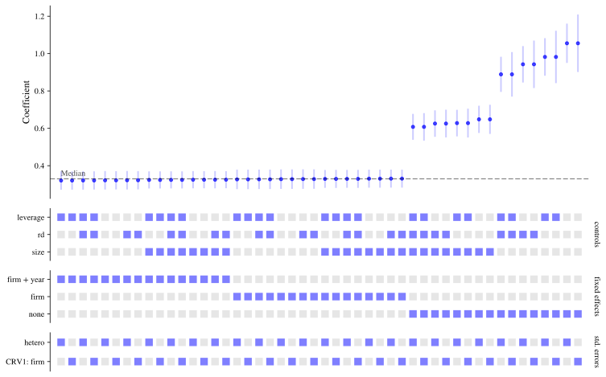

# Specification Curve


Specification curve analysis for Python

# Specification Curve

Run every defensible regression and see all of the estimates in one chart.

`uv add specification-curve`


[See the features](user-guide/features.html) [API reference](reference/index.html)


Replay


Specification Curve is a Python package that performs specification curve analysis; it helps with the problem of the "garden of forking paths" (many defensible choices) when doing analysis by running many regressions and summarising the effects in an easy to digest chart. Estimation is done by [pyfixest](https://pyfixest.org/), so specifications can vary the outcome, the regressor of interest, controls, fixed effects, instruments, standard errors, weights, the sample and the estimator (OLS, Poisson, logit, probit and quantile regression).


[](https://pypi.org/project/specification_curve/) [](https://pypi.org/project/specification_curve) [](https://opensource.org/licenses/MIT) [](https://github.com/aeturrell/specification_curve/actions?workflow=Tests) [](https://codecov.io/gh/aeturrell/specification_curve) [](https://doi.org/10.5281/zenodo.17523510) [](https://pepy.tech/projects/Specification_curve)


# Introduction

When specifying a causal model, modellers have a number of options. These can be informed by field intelligence, priors, and even misguided attempts to find a significant result. Even with the best of intentions, research teams can reach entirely different conclusions using the same, or similar, data because of different choices made in preparing data or in modelling it.

Typically this happens when there isn't a clear way to do "feature engineering" on the data or the data are imperfect in some way. For example, you have a high frequency time series which needs to be aggregated to a lower frequency: you could take the maximum, the minimum, or the average over each high frequency time period. A different choice may be appropriate in different settings.

There's formal evidence that researchers really do make different decisions; one study <span class="citation" data-cites="silberzahn2018many">(<a href="#ref-silberzahn2018many" role="doc-biblioref">Silberzahn et al. 2018</a>)</span> gave the same research question--whether soccer referees are more likely to give red cards to players with dark skin tones than to players with light skin tones--to 29 different teams. From the abstract of that paper:

> Analytic approaches varied widely across the teams, and the estimated effect sizes ranged from 0.89 to 2.93 (Mdn = 1.31) in odds-ratio units. Twenty teams (69%) found a statistically significant positive effect, and 9 teams (31%) did not observe a significant relationship. Overall, the 29 different analyses used 21 unique combinations of covariates. Neither analysts' prior beliefs about the effect of interest nor their level of expertise readily explained the variation in the outcomes of the analyses. Peer ratings of the quality of the analyses also did not account for the variability.

So not only can different decisions made, but there seems to be no clearly identifiable reason for them!

There have since been a number of papers that find similar conclusions <span class="citation" data-cites="huntington2021influence">(<a href="#ref-huntington2021influence" role="doc-biblioref">Huntington-Klein et al. 2021</a>)</span>.

Specification curves have been invented <span class="citation" data-cites="simonsohn2020specification">([Simonsohn et al. 2020](#ref-simonsohn2020specification))</span> as a way to better grasp the garden of forking paths that analysts face, and help them show how sensitive their results are to alternative specifications.

More than one piece of software <span class="citation" data-cites="masur2019specr">([Masur and Scharkow 2019](#ref-masur2019specr))</span> has appeared to help researchers and analysts use this technique: **specification curve** is one such package!


# Quickstart

Here's an example of using **Specification Curve**. The example data are a made-up panel of firms, in which being `treated` raises log sales by 0.3, but firms that would have had high sales anyway are more likely to be treated.

We ask how the estimated effect of treatment depends on which controls are included, whether firm and year fixed effects are used, and how the standard errors are computed.


``` python
import specification_curve as sc

df = sc.load_example_panel()
df.head()
```


|  | firm | year | industry | state | treated | eligible | size | age | leverage | rd | sales | patents | exporter | weight |
|----|----|----|----|----|----|----|----|----|----|----|----|----|----|----|
| 0 | 0 | 2010 | 5 | 24 | 1 | 1 | 3.759599 | 13.0 | 0.517282 | 0.066929 | 447.968245 | 4 | 1 | 1.49689 |
| 1 | 0 | 2011 | 5 | 24 | 1 | 0 | 4.021226 | 14.0 | 0.528749 | 0.064437 | 532.575250 | 1 | 0 | 1.49689 |
| 2 | 0 | 2012 | 5 | 24 | 0 | 0 | 4.284728 | 15.0 | 0.343254 | 0.054897 | 158.264040 | 1 | 1 | 1.49689 |
| 3 | 0 | 2013 | 5 | 24 | 0 | 1 | 2.724891 | 16.0 | 0.154377 | 0.066043 | 202.515415 | 1 | 1 | 1.49689 |
| 4 | 0 | 2014 | 5 | 24 | 0 | 0 | 3.813143 | 17.0 | 0.145118 | 0.045717 | 170.363117 | 2 | 0 | 1.49689 |


``` python
sco = sc.SpecificationCurve(
    df,
    y="log(sales)",
    x="treated",
    controls=["size", "leverage", "rd"],
    fe=[None, "firm", "firm + year"],
    vcov=["hetero", {"CRV1": "firm"}],
)
sco.fit()
sco.plot();
```


<figure class="figure">
<p></p>
</figure>


Each column is one specification. The top panel shows the estimated coefficient on `treated` with its confidence interval, and the panels underneath show which choices that specification makes. Markers are coloured blue when the coefficient is positive and significant (at the 0.05 level), red when it is negative and significant, and black otherwise.

Here, the specifications without firm fixed effects overstate the effect, and those with them are close to the true value.

You can also describe the specifications with a [pyfixest formula](https://pyfixest.org/quickstart.html). Its multiple-estimation operators define the choices: several outcomes (`y1 + y2 ~ ...`), `sw()` (one of these terms at a time) and `sw0()` (one at a time, or none). **Specification Curve** adds `comb()` and `comb0()`, which stand for every combination of their terms (with `comb0()` including none of them). The `x` argument names the coefficient to plot.

This formula describes the same specifications as above:


``` python
sco = sc.SpecificationCurve(
    df,
    "log(sales) ~ treated + comb0(size, leverage, rd) | sw0(firm, firm + year)",
    x="treated",
    vcov=["hetero", {"CRV1": "firm"}],
)
sco.fit()
sco.plot();
```


<figure class="figure">
<p></p>
</figure>


The [features page](./user-guide/features.html) shows everything else: other estimators, instrumental variables, samples, customising the chart, and statistical inference on the curve as a whole.


# Installation

You can install **Specification Curve** via uv:

``` bash
$ uv add specification-curve
```

To install the development version from git, use:

``` bash
$ pip install git+https://github.com/aeturrell/specification_curve.git
```


# License

Distributed under the terms of the [MIT license](https://opensource.org/licenses/MIT).


# Citing Specification Curve

You can find full citation information at the following link: <https://zenodo.org/badge/latestdoi/282989537>.

Using **Specification Curve** in your paper? Let us know by raising an issue beginning with "citation".


# Similar Packages

In RStats, there is [specr](https://github.com/masurp/specr) (which inspired many design choices in this package) and [spec_chart](https://github.com/ArielOrtizBobea/spec_chart). Some of the example data in this package is the same as in specr, but please note that results have not been cross-checked across packages.


# References


Huntington-Klein, Nick, Andreu Arenas, Emily Beam, et al. 2021. "The Influence of Hidden Researcher Decisions in Applied Microeconomics." *Economic Inquiry* 59 (3): 944-60.


Masur, Philipp K., and Michael Scharkow. 2019. *Specr: Statistical Functions for Conducting Specification Curve Analyses (Version 0.2.1)*. <https://github.com/masurp/specr>.


Silberzahn, Raphael, Eric L Uhlmann, Daniel P Martin, et al. 2018. "Many Analysts, One Data Set: Making Transparent How Variations in Analytic Choices Affect Results." *Advances in Methods and Practices in Psychological Science* 1 (3): 337-56.


Simonsohn, Uri, Joseph P Simmons, and Leif D Nelson. 2020. "Specification Curve Analysis." *Nature Human Behaviour* 4 (11): 1208-14.


### Links

[View on PyPI](https://pypi.org/project/specification_curve/)\


### AI / Agents

[Skills](skills.md)\
[llms.txt](llms.txt)\
[llms-full.txt](llms-full.txt)\


### Meta

**Requires:** Python `>=3.12`\
[Package Info](package-info.md)
