# Features

Let's see **Specification Curve**'s features in action.


# Basic use

We'll use an example data set that comes with the package: a synthetic panel of firms observed over several years. Some firms are `treated` in some years, and the question is what effect treatment has on `sales`. Because the data are made up, we know the answer: treatment raises log sales by 0.3. But firms with a high unobserved firm-level effect are more likely to be treated, so analyses that ignore this will overstate the effect.


``` python
import specification_curve as sc

df = sc.load_example_panel()
df.head()
```


|  | firm | year | industry | state | treated | eligible | size | age | leverage | rd | sales | patents | exporter | weight |
|----|----|----|----|----|----|----|----|----|----|----|----|----|----|----|
| 0 | 0 | 2010 | 5 | 24 | 1 | 1 | 3.759599 | 13.0 | 0.517282 | 0.066929 | 447.968245 | 4 | 1 | 1.49689 |
| 1 | 0 | 2011 | 5 | 24 | 1 | 0 | 4.021226 | 14.0 | 0.528749 | 0.064437 | 532.575250 | 1 | 0 | 1.49689 |
| 2 | 0 | 2012 | 5 | 24 | 0 | 0 | 4.284728 | 15.0 | 0.343254 | 0.054897 | 158.264040 | 1 | 1 | 1.49689 |
| 3 | 0 | 2013 | 5 | 24 | 0 | 1 | 2.724891 | 16.0 | 0.154377 | 0.066043 | 202.515415 | 1 | 1 | 1.49689 |
| 4 | 0 | 2014 | 5 | 24 | 0 | 0 | 3.813143 | 17.0 | 0.145118 | 0.045717 | 170.363117 | 2 | 0 | 1.49689 |


To create a specification curve, say which outcome (`y`) and which regressor of interest (`x`) you care about, and which choices should vary. Below, each of three control variables is switched in and out, giving eight specifications. [fit()](../reference/SpecificationCurve.md#specification_curve.SpecificationCurve.fit) estimates them and [plot()](../reference/SpecificationCurve.md#specification_curve.SpecificationCurve.plot) draws the curve.


``` python
sco = sc.SpecificationCurve(
    df,
    y="log(sales)",
    x="treated",
    controls=["size", "age", "leverage"],
)
sco.fit()
sco.plot()
```


<figure class="figure">
<p>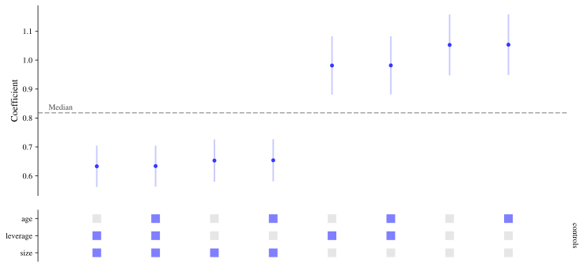</p>
</figure>


Each column is one specification. The top panel shows the estimated coefficient on `treated` with its 95% confidence interval, sorted from smallest to largest. The panel underneath shows which controls each specification includes. Markers are coloured blue when the coefficient is positive and significant (at the 0.05 level), red when it is negative and significant, and black otherwise.

All estimation is done by [pyfixest](https://pyfixest.org/), and every term is written in its formula syntax. That means transformations such as `log(sales)`, interactions such as `size:leverage`, and categorical terms such as `i(industry)` or `C(industry)` can be used anywhere a variable name can.


# Choosing controls

`controls` are included in every combination. Three more arguments shape which combinations are run:

- `always` names terms that are in every specification;
- `exclude` lists groups of controls that should never appear together (for example, two measures of the same thing);
- `min_controls` and `max_controls` limit how many controls a specification has.


``` python
sco = sc.SpecificationCurve(
    df,
    y="log(sales)",
    x="treated",
    controls=["size", "age", "log(age)", "leverage"],
    always="i(industry)",
    exclude=[["age", "log(age)"]],
    min_controls=1,
)
sco.fit()
sco.plot()
```


<figure class="figure">
<p>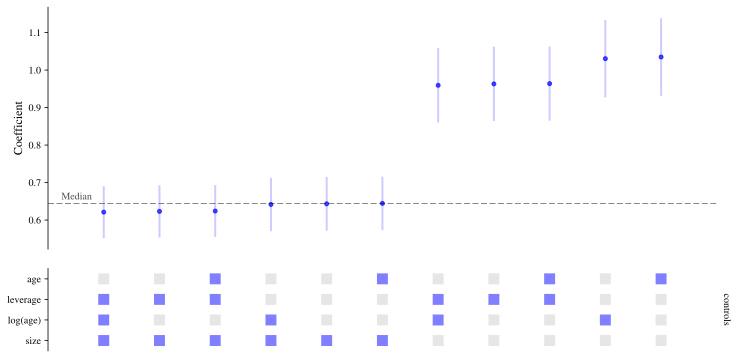</p>
</figure>


# Fixed effects

Fixed effects are given with `fe`, as a list of alternatives. Each is written as in a pyfixest formula, and `None` means no fixed effects. pyfixest absorbs fixed effects rather than estimating a coefficient for each one, so this stays fast even with many firms.

Here the specifications without firm fixed effects overstate the effect, as we expected, while those with them recover something close to the true value of 0.3. Passing `color_by="fe"` colours the curve by this choice to make that easy to see.


``` python
sco = sc.SpecificationCurve(
    df,
    y="log(sales)",
    x="treated",
    controls=["size", "leverage", "rd"],
    fe=[None, "firm", "firm + year"],
)
sco.fit()
sco.plot(color_by="fe")
```


<figure class="figure">
<p>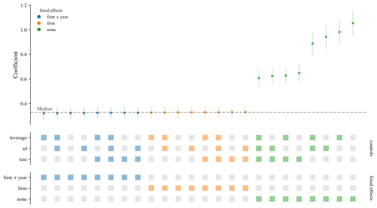</p>
</figure>


# Standard errors

How standard errors are computed is often as contestable as what is in the model. `vcov` takes a list of alternatives, each in the form pyfixest accepts: for example `"iid"`, `"hetero"`, or `{"CRV1": "firm"}` for standard errors clustered by firm. Leaving it out uses pyfixest's default.

Specifications that differ only in their standard errors share a single model fit, so adding alternatives costs very little.


``` python
sco = sc.SpecificationCurve(
    df,
    y="log(sales)",
    x="treated",
    controls=["size", "leverage"],
    fe=["firm", "firm + year"],
    vcov=["iid", "hetero", {"CRV1": "firm"}, {"CRV1": "state"}],
)
sco.fit()
sco.plot()
```


<figure class="figure">
<p>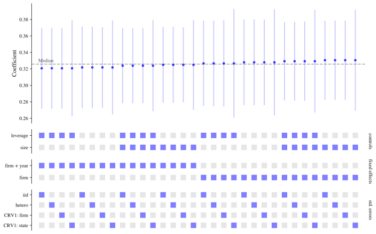</p>
</figure>


# Describing specifications with a formula

Instead of keyword arguments you can describe the specifications with a single pyfixest formula, using its multiple-estimation syntax to define the choices:

- several outcomes: `y1 + y2 ~ ...`
- `sw(a, b)`: `a` or `b`, one at a time
- `sw0(a, b)`: as `sw`, or neither
- `csw(a, b)`: `a`, then `a + b` (cumulative); `csw0` also includes neither

**Specification Curve** adds two operators of its own for the most common need in a specification curve:

- `comb(a, b)`: every combination of `a` and `b`
- `comb0(a, b)`: every combination, including neither

These work for fixed effects too, after the `|`. The `x` argument is still needed to say which coefficient to plot. The formula below describes the same specifications as the fixed effects example above.


``` python
sco = sc.SpecificationCurve(
    df,
    "log(sales) ~ treated + comb0(size, leverage, rd) | sw0(firm, firm + year)",
    x="treated",
)
sco.fit()
sco.plot()
```


<figure class="figure">
<p>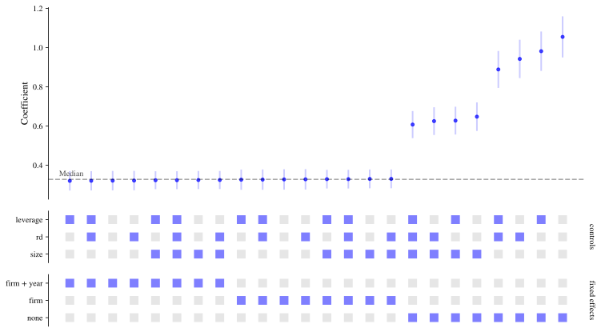</p>
</figure>


The other arguments (`vcov`, `model`, `weights`, `subsets`, `exclude` and so on) can be combined with a formula.


# Several outcomes and regressors of interest

`y` and `x` take lists too. With several `x`, each specification uses one of them, and the coefficient plotted is the one on that variable. Below, the outcome is the log of sales or the log of sales plus one, and the regressor of interest is either treatment or eligibility for it.


``` python
sco = sc.SpecificationCurve(
    df,
    y=["log(sales)", "log(sales + 1)"],
    x=["treated", "eligible"],
    controls=["size", "leverage"],
    fe="firm + year",
)
sco.fit()
sco.plot()
```


<figure class="figure">
<p>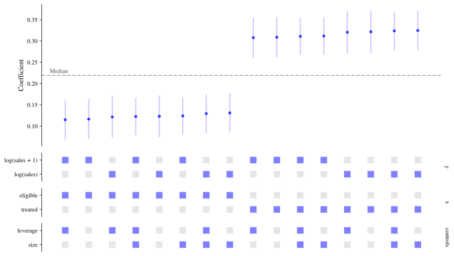</p>
</figure>


Take care when the alternatives are on different scales: the coefficients of a model for `sales` and one for `log(sales)` are not comparable, and putting them on one chart would be misleading.


# Different samples

`subsets` runs every specification on several samples. It maps a name for each sample to a query (as used by `DataFrame.query`), with `None` meaning all rows.


``` python
sco = sc.SpecificationCurve(
    df,
    y="log(sales)",
    x="treated",
    controls=["size", "leverage"],
    fe="firm + year",
    subsets={
        "all": None,
        "from 2012": "year >= 2012",
        "industries 0 to 2": "industry <= 2",
    },
)
sco.fit()
sco.plot()
```


<figure class="figure">
<p>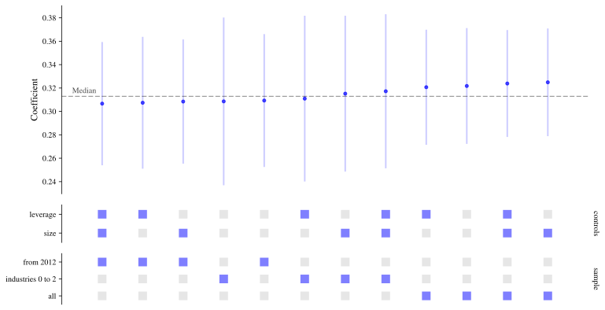</p>
</figure>


The helper [subsets_by](../reference/subsets_by.md#specification_curve.subsets_by) builds one sample per level of a column, for the common case of running the analysis separately for each group:


``` python
sc.subsets_by(df, "industry", include_all=True)
```


    {'all': None,
     'industry = 0': '`industry` == 0',
     'industry = 1': '`industry` == 1',
     'industry = 2': '`industry` == 2',
     'industry = 3': '`industry` == 3',
     'industry = 4': '`industry` == 4',
     'industry = 5': '`industry` == 5'}


## Missing values

In the example data, `age` and `leverage` have some missing values. (Firm `age` rises by one each year, so it should not be combined with firm and year fixed effects together: pyfixest would drop it as collinear.) By default, within each sample every specification is estimated on the same rows: those that are complete for all the variables used by any specification. That way differences between estimates come from the specification and not from a changing sample. Passing `common_sample=False` lets each specification use every row it can instead. The number of observations each one used is in the results, and `show_nobs=True` adds it to the chart.


``` python
sco = sc.SpecificationCurve(
    df,
    y="log(sales)",
    x="treated",
    controls=["size", "age", "leverage"],
    common_sample=False,
)
sco.fit()
sco.plot(show_nobs=True)
```


<figure class="figure">
<p>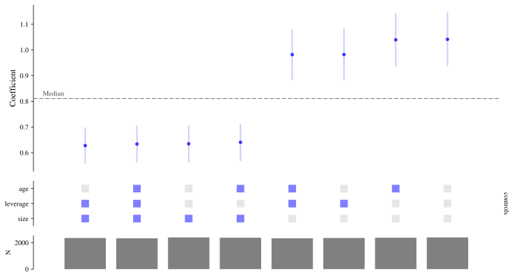</p>
</figure>


# Other estimators

The default estimator is OLS (pyfixest's `feols`). The `model` argument selects others:

- `"fepois"`: Poisson regression, for counts and other non-negative outcomes;
- `"feglm"`: generalised linear models, with `family` set to `"logit"`, `"probit"`, `"gaussian"` or `"poisson"`;
- `"quantreg"`: quantile regression, with `quantile` (the median by default).

Here is a Poisson specification curve for the number of patents, with and without firm fixed effects:


``` python
sco = sc.SpecificationCurve(
    df,
    y="patents",
    x="treated",
    controls=["size", "leverage"],
    fe=[None, "firm", "firm + year"],
    model="fepois",
    vcov={"CRV1": "firm"},
)
sco.fit()
sco.plot()
```


<figure class="figure">
<p>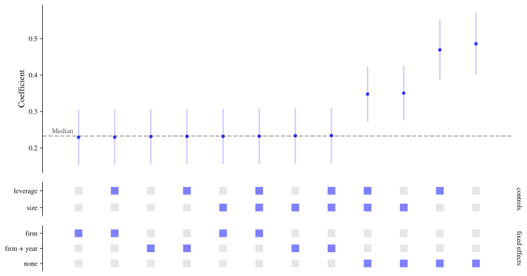</p>
</figure>


`model`, `family` and `quantile` accept lists as well, so the estimator can itself be one of the choices. Below, whether a firm exports is modelled with a linear probability model, a logit and a probit. (The coefficients of these three are on different scales, so compare signs and significance, not sizes.)


``` python
sco = sc.SpecificationCurve(
    df,
    y="exporter",
    x="treated",
    controls=["size", "leverage"],
    model=["feols", "feglm"],
    family=["logit", "probit"],
    vcov="hetero",
)
sco.fit()
sco.plot()
```


<figure class="figure">
<p>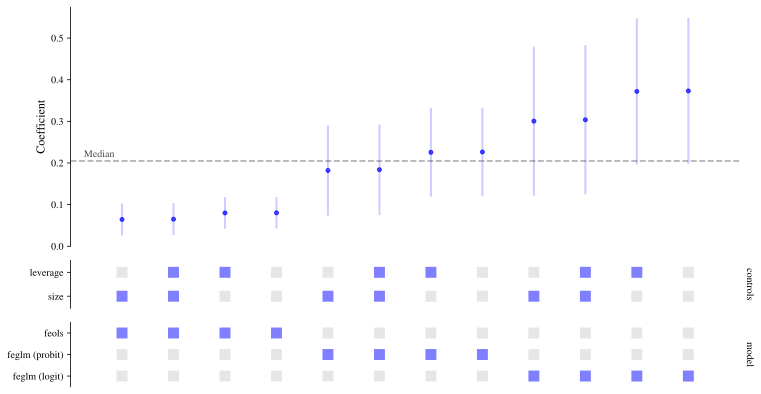</p>
</figure>


And quantile regressions at three quantiles:


``` python
sco = sc.SpecificationCurve(
    df,
    y="log(sales)",
    x="treated",
    controls=["size", "leverage"],
    model="quantreg",
    quantile=[0.25, 0.5, 0.75],
)
sco.fit()
sco.plot()
```


<figure class="figure">
<p>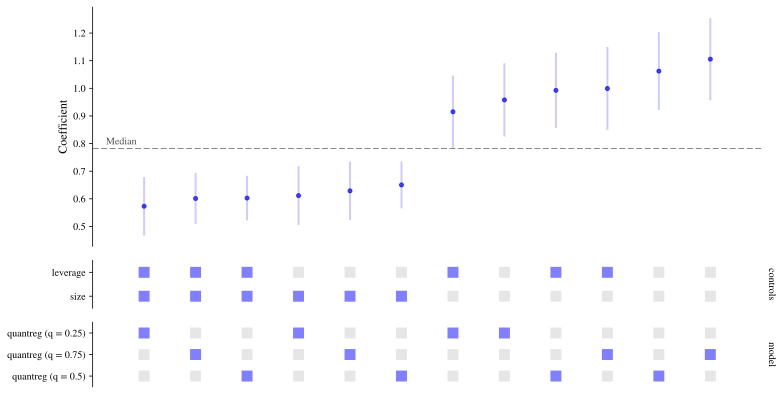</p>
</figure>


Not every estimator supports every option: quantile regression cannot be combined with fixed effects, weights or instruments, and instruments are only available with `"feols"`. If the choices you ask for include a combination that cannot be estimated you get an error that says which. Passing `skip_invalid=True` leaves those combinations out instead.


# Instrumental variables

`iv` gives the first stage in pyfixest's syntax, `"endogenous ~ instruments"`. As with the other arguments it can be a list, and `None` means no instruments. In the example data, `eligible` was assigned at random and makes treatment more likely, so it can be used as an instrument for `treated`.

Without firm fixed effects, OLS overstates the effect. The instrumental variable estimates are closer to the true value of 0.3 whether or not fixed effects are included, though they are much less precise.


``` python
sco = sc.SpecificationCurve(
    df,
    y="log(sales)",
    x="treated",
    controls=["size", "leverage"],
    fe=[None, "firm + year"],
    iv=[None, "treated ~ eligible"],
    vcov="hetero",
)
sco.fit()
sco.plot()
```


<figure class="figure">
<p>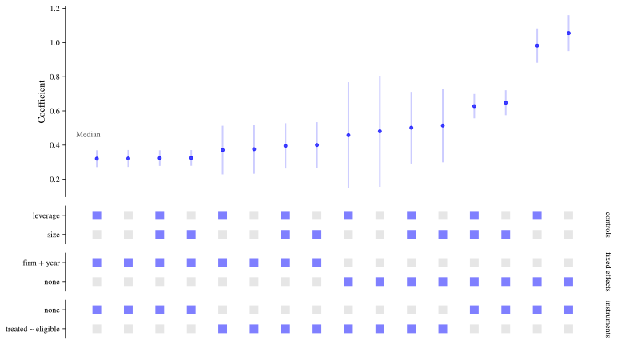</p>
</figure>


# Weights

`weights` names a column of weights, or a list of alternatives in which `None` means unweighted.


``` python
sco = sc.SpecificationCurve(
    df,
    y="log(sales)",
    x="treated",
    controls=["size", "leverage"],
    fe="firm + year",
    weights=[None, "weight"],
)
sco.fit()
sco.plot()
```


<figure class="figure">
<p>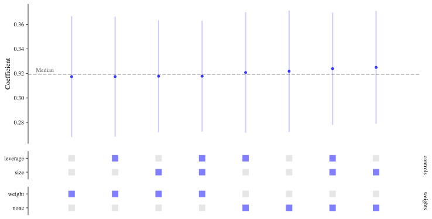</p>
</figure>


# Working with the results

Before fitting, [grid](../reference/SpecificationCurve.md#specification_curve.SpecificationCurve.grid) shows the specifications that will be run. After fitting, [results](../reference/SpecificationCurve.md#specification_curve.SpecificationCurve.results) has the same rows with the estimates added: the coefficient on the regressor of interest, its standard error, test statistic, p-value and confidence interval, and the number of observations.


``` python
sco.results.drop(columns=["model", "family", "quantile", "iv", "subset"])
```


|  | spec_id | y | x | controls | always | fe | vcov | weights | formula | estimate | se | statistic | pvalue | ci_low_95 | ci_high_95 | nobs | error |
|----|----|----|----|----|----|----|----|----|----|----|----|----|----|----|----|----|----|
| 0 | 0 | log(sales) | treated | () | () | firm + year | iid | None | log(sales) ~ treated \| firm + year | 0.321758 | 0.025244 | 12.745942 | 0.0 | 0.272251 | 0.371264 | 2355 | None |
| 1 | 1 | log(sales) | treated | (size,) | () | firm + year | iid | None | log(sales) ~ treated + size \| firm + year | 0.324884 | 0.023463 | 13.846509 | 0.0 | 0.278870 | 0.370898 | 2355 | None |
| 2 | 2 | log(sales) | treated | (leverage,) | () | firm + year | iid | None | log(sales) ~ treated + leverage \| firm + year | 0.320697 | 0.025078 | 12.787773 | 0.0 | 0.271515 | 0.369879 | 2355 | None |
| 3 | 3 | log(sales) | treated | (size, leverage) | () | firm + year | iid | None | log(sales) ~ treated + size + leverage \| firm ... | 0.323848 | 0.023296 | 13.901475 | 0.0 | 0.278162 | 0.369534 | 2355 | None |
| 4 | 4 | log(sales) | treated | () | () | firm + year | iid | weight | log(sales) ~ treated \| firm + year | 0.317325 | 0.025161 | 12.611908 | 0.0 | 0.267982 | 0.366669 | 2355 | None |
| 5 | 5 | log(sales) | treated | (size,) | () | firm + year | iid | weight | log(sales) ~ treated + size \| firm + year | 0.317686 | 0.023293 | 13.638792 | 0.0 | 0.272006 | 0.363366 | 2355 | None |
| 6 | 6 | log(sales) | treated | (leverage,) | () | firm + year | iid | weight | log(sales) ~ treated + leverage \| firm + year | 0.317365 | 0.024946 | 12.722286 | 0.0 | 0.268444 | 0.366286 | 2355 | None |
| 7 | 7 | log(sales) | treated | (size, leverage) | () | firm + year | iid | weight | log(sales) ~ treated + size + leverage \| firm ... | 0.317723 | 0.023070 | 13.771882 | 0.0 | 0.272479 | 0.362967 | 2355 | None |


This is an ordinary data frame, so it can be filtered, summarised or saved (for example with `sco.results.to_csv("results.csv")`). Printing the object gives a summary:


``` python
sco
```


    Specification curve
    -------------------
    Specifications: 8
      y: log(sales)
      x: treated
      controls: leverage, size
      fe: firm + year
      model: feols
      vcov: default
      weights: weight
      subset: all

    Fitted: 8 of 8 succeeded
      estimate: median 0.319, min 0.317, max 0.325
      significant at 0.05: 100%


A few options to [fit()](../reference/SpecificationCurve.md#specification_curve.SpecificationCurve.fit) are useful here:

- `ci_levels=(0.9, 0.95)` stores (and plots) confidence intervals at several levels;
- `keep_models=True` keeps the fitted pyfixest models in `sco.models`, keyed by `spec_id`, for when you want a regression table or further tests for particular specifications;
- other keyword arguments, such as `ssc` or `fixef_rm`, are passed on to pyfixest.

If a specification cannot be estimated, it stays in the results with the reason in its `error` column and is left out of the chart. Pass `on_error="raise"` to stop at the first failure instead.


# Large numbers of specifications

The number of specifications multiplies quickly. Eight controls, two outcomes and three sets of fixed effects already give 1,536. [n_specs](../reference/SpecificationCurve.md#specification_curve.SpecificationCurve.n_specs) tells you how many there are before you fit anything.


``` python
sco = sc.SpecificationCurve(
    df,
    y=["log(sales)", "log(sales + 1)"],
    x="treated",
    controls=[
        "size",
        "leverage",
        "rd",
        "size:leverage",
        "size:rd",
        "exporter",
        "patents",
        "eligible",
    ],
    fe=[None, "firm", "firm + year"],
)
sco.n_specs
```


    1536


There are two ways to keep this manageable. `n_jobs` estimates specifications in parallel, and `max_specs` estimates a random sample of them (with `seed` to make the sample reproducible). The chart switches to a more compact style when there are many specifications.


``` python
sco.fit(max_specs=500, seed=0, n_jobs=2)
sco.plot()
```


<figure class="figure">
<p>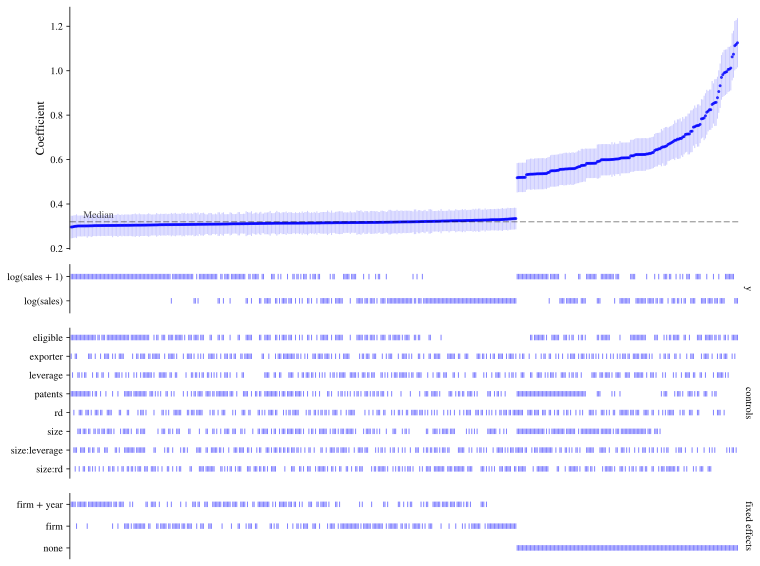</p>
</figure>


As a guide to speed, here are timings for a curve of 192 OLS specifications with up to two sets of fixed effects. They come from `benchmarks/benchmark.py` in the repository, last run in November 2026 with version 0.4.0 (pyfixest 0.70.0, Python 3.12.12) on Apple M5 Max with 18 cores. Every run is logged in `benchmarks/results.csv`.

|  | 5,000 rows | 200,000 rows |
|----|----|----|
| [fit()](../reference/SpecificationCurve.md#specification_curve.SpecificationCurve.fit) | 1.0 s | 3.3 s |
| `fit(n_jobs=4)` | 0.3 s | 1.3 s |
| [fit()](../reference/SpecificationCurve.md#specification_curve.SpecificationCurve.fit) with three kinds of standard errors (576 specifications) | 1.4 s | 6.6 s |
| `fit_null(n_boot=50)` for a curve of 16 specifications | 4.8 s | 17.9 s |


# Customising the chart

[plot()](../reference/SpecificationCurve.md#specification_curve.SpecificationCurve.plot) has options for the most common changes:

- `sort_by` orders the specifications by a column of the results, or by several;
- `color_by` colours them by one of the choices instead of by significance;
- `panels` says which choices are shown underneath, and in what order;
- `labels` replaces names with nicer ones for display;
- `highlight` flags a preferred specification;
- `ci_levels` and `alpha` choose the confidence intervals drawn and the significance level used for colouring.

Often, in practice, you will have a *preferred* specification that you use as your main estimate. `highlight` takes the values that identify it (or its `spec_id`, or a query string).


``` python
sco = sc.SpecificationCurve(
    df,
    y="log(sales)",
    x="treated",
    controls=["size", "leverage", "rd"],
    fe=[None, "firm", "firm + year"],
    vcov=["hetero", {"CRV1": "firm"}],
)
sco.fit(ci_levels=(0.9, 0.99))
sco.plot(
    highlight={
        "controls": ["size", "leverage", "rd"],
        "fe": "firm + year",
        "vcov": "CRV1: firm",
    },
    labels={
        "fe": "Fixed effects",
        "none": "None",
        "firm": "Firm",
        "firm + year": "Firm and year",
        "vcov": "Standard errors",
        "hetero": "Robust",
        "CRV1: firm": "Clustered by firm",
    },
)
```


<figure class="figure">
<p>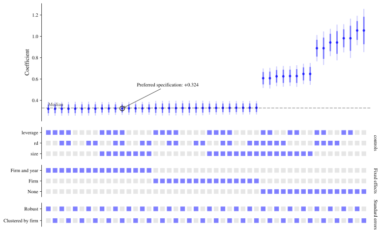</p>
</figure>


``` python
sco.plot(sort_by=["fe", "vcov"], color_by="vcov", panels=["fe", "controls"])
```


<figure class="figure">
<p>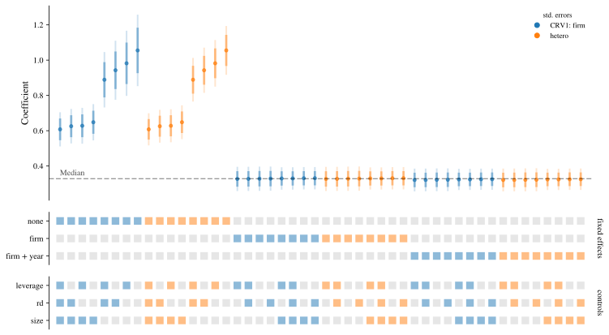</p>
</figure>


[plot()](../reference/SpecificationCurve.md#specification_curve.SpecificationCurve.plot) returns the matplotlib figure and a dictionary of its axes (`"curve"` for the top panel, then one per panel underneath), so anything else can be changed afterwards. It never changes matplotlib's global settings, and `style=False` turns off the package's own fonts and sizes so that your settings apply.

To put a curve inside a figure of your own, pass a figure or subfigure as `fig`. The function `sc.plot_curve` does the same as the [plot](../reference/SpecificationCurve.md#specification_curve.SpecificationCurve.plot) method for any results data frame, which is handy for results you saved earlier or combined from several curves.


``` python
import matplotlib.pyplot as plt

fig = plt.figure(figsize=(14, 6))
left, right = fig.subfigures(1, 2)
results = sco.results
_, axes = sc.plot_curve(results[results["fe"].isna()], fig=left, panels=["controls"])
axes["curve"].set_title("No fixed effects")
_, axes = sc.plot_curve(results[results["fe"].notna()], fig=right, panels=["controls"])
axes["curve"].set_title("With fixed effects")
```


<figure class="figure">
<p>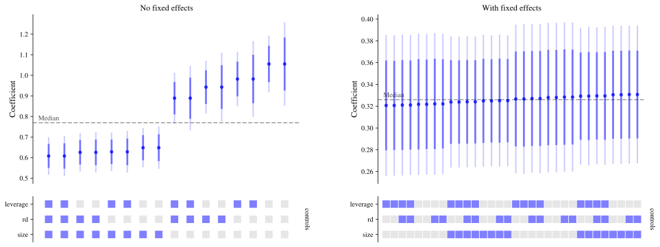</p>
</figure>


To save a chart, pass a path to [plot()](../reference/SpecificationCurve.md#specification_curve.SpecificationCurve.plot); the format is taken from the file extension.

``` python
sco.plot("specification_curve.pdf")
```


# Inference under the null

A specification curve shows how much an estimate varies, but it is natural to also ask: taking all of these specifications together, how inconsistent are the results with there being no effect at all? Individual p-values cannot answer that, because the specifications are far from independent. <span class="citation" data-cites="simonsohn2020specification">([Simonsohn et al. 2020](#ref-simonsohn2020specification))</span> propose answering it by resampling: re-estimate the whole curve many times on data in which the null hypothesis is true, and see how unusual the observed curve is by comparison.

[fit_null()](../reference/SpecificationCurve.md#specification_curve.SpecificationCurve.fit_null) does this. By default it uses a bootstrap in which each specification's estimated effect is first removed from the outcome, so that the null holds, and then rows are resampled with replacement. Because this is panel data we resample whole firms, with `cluster="firm"`.

You should use a large number of resamples for results you rely on (500, say), but be warned that each one re-estimates every specification; `n_jobs` runs them in parallel. We use a small number here to keep things quick.


``` python
sco = sc.SpecificationCurve(
    df,
    y="log(sales)",
    x="treated",
    controls=["size", "leverage"],
    fe=["firm", "firm + year"],
    vcov={"CRV1": "firm"},
)
sco.fit()
sco.fit_null(n_boot=50, cluster="firm", seed=0)
sco.null_summary
```


|                   | observed   | p-value  |
|-------------------|------------|----------|
| median            | 0.325776   | 0.019608 |
| share significant | 1.000000   | 0.019608 |
| Stouffer Z        | 104.837880 | 0.019608 |


The summary has three tests. Each compares a feature of the observed curve with its distribution across the resamples: the median estimate, the share of estimates that are statistically significant, and Stouffer's Z, which combines the evidence of all the specifications. The p-value is the share of resamples at least as extreme as what was observed. Here all three are as small as they can be with this many resamples, as they should be: the effect is real.

The curve expected under the null, with a band covering 95% of the resamples, can be added to the chart:


``` python
sco.plot(show_null_curve=True)
```


<figure class="figure">
<p>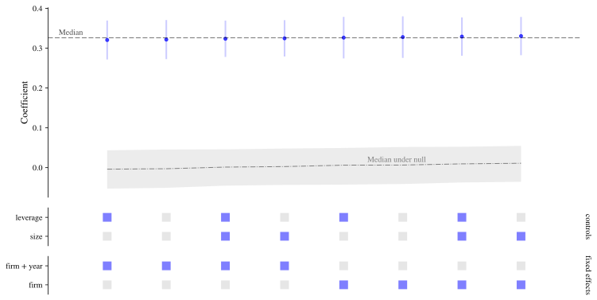</p>
</figure>


## Choosing a resampling method

There are three ways of generating data in which the null is true, chosen with `method`:

- **`"bootstrap"`** (the default for linear models). Each specification's estimated effect is removed from its outcome, y^\* = y - \hat\beta x, so that the regressor of interest has no effect on y^\* by construction, and then rows (or whole clusters) are drawn with replacement.
- **`"bayesian-bootstrap"`**, the Bayesian bootstrap <span class="citation" data-cites="rubin1981bayesian andrews2026praise">([Rubin 1981](#ref-rubin1981bayesian); [Andrews et al. 2026](#ref-andrews2026praise))</span>. The null is imposed in the same way, but instead of drawing rows with replacement every row (or cluster) is kept and given a random weight from a flat Dirichlet distribution, scaled so that the weights average one. Where the ordinary bootstrap gives each row a whole number of copies, possibly zero, the Bayesian bootstrap gives it a positive, continuously varying weight.
- **`"permutation"`**. The regressor of interest is shuffled between rows (or clusters), which breaks any link between it and the outcome.

Which methods you can use depends on the estimators and designs in the curve:

| Specifications | `"bootstrap"` | `"bayesian-bootstrap"` | `"permutation"` |
|----|:--:|:--:|:--:|
| Linear (`model="feols"`) | ✓ | ✓ | ✓ † |
| Instrumental variables (`feols` with `iv`) | ✓ | ✓ | ✗ |
| Poisson (`"fepois"`) and other GLMs (`"feglm"`) | ✗ | ✗ | ✓ † |
| Quantile regression (`"quantreg"`) | ✗ | ✗ | ✓ † |
| With `weights` | ✓ | ✓ ‡ | ✓ † |
| With `cluster` | ✓ (resamples clusters) | ✓ (one weight per cluster) | ✓ † (the regressor must be constant within clusters) |
| With `strata` | ✓ | ✓ | ✓ † |

† Only valid if the regressor of interest is as good as randomly assigned (within `strata`, if given).\
‡ The random weights multiply your own; your weights must be analytic weights (pyfixest's default, `weights_type="aweights"`).

The two bootstraps need every specification to be linear because removing \hat\beta x from the outcome only imposes the null in a linear model: in a Poisson model or a logit it does not. If the curve mixes linear and non-linear estimators, `method="auto"` raises an error and asks you to choose. Permutation is not available for instrumental-variable specifications, because shuffling the endogenous regressor but not its instruments breaks the first stage.


## The Bayesian bootstrap

The two bootstraps give very similar answers in large samples. The Bayesian bootstrap does better when resampling can produce data in which a specification cannot be estimated. With the ordinary bootstrap a resample may, by chance, contain no treated units, no rows of some fixed-effect level, or too few clusters; the specifications that cannot be estimated are missing from that resample, and a resample in which fewer than `min_valid` of them could be estimated is left out (with a warning). Because the Bayesian bootstrap never leaves a row out, that does not happen. Its null distributions are also smoother, which helps with few clusters.

Here is an extreme case: eight clusters, only one of them treated. Every ordinary bootstrap resample that misses the treated cluster has no variation in the regressor of interest.


``` python
import warnings

import numpy as np
import pandas as pd

rng = np.random.default_rng(0)
small = pd.DataFrame({"group": np.repeat(np.arange(8), 5), "a": rng.normal(size=40)})
small["x"] = (small["group"] == 0).astype(float)
small["y"] = small["a"] + 0.5 * small["x"] + rng.normal(size=40)
sco_small = sc.SpecificationCurve(small, y="y", x="x", controls=["a"]).fit()

for method in ["bootstrap", "bayesian-bootstrap"]:
    with warnings.catch_warnings(record=True) as caught:
        warnings.simplefilter("always")
        sco_small.fit_null(
            n_boot=200, method=method, cluster="group", seed=0, progress=False
        )
    left_out = [str(w.message) for w in caught if "left out" in str(w.message)]
    print(f"{method}: {left_out[0] if left_out else 'no resamples were left out.'}")
```


    bootstrap: 79 of 200 resamples were left out because fewer than 50% of the specifications could be estimated in them.
    bayesian-bootstrap: no resamples were left out.


On the panel data from above, it is used like this:


``` python
sco = sc.SpecificationCurve(
    df,
    y="log(sales)",
    x="treated",
    controls=["size", "leverage"],
    fe=["firm", "firm + year"],
    vcov={"CRV1": "firm"},
)
sco.fit()
sco.fit_null(n_boot=50, method="bayesian-bootstrap", cluster="firm", seed=0)
sco.null_summary
```


|                   | observed   | p-value  |
|-------------------|------------|----------|
| median            | 0.325776   | 0.019608 |
| share significant | 1.000000   | 0.019608 |
| Stouffer Z        | 104.837880 | 0.019608 |


Although it has "Bayesian" in its name, the result here is the same kind of frequentist p-value as with the other methods: the Bayesian bootstrap is simply used as a way of generating resamples in which the null holds.


## Permutation

For non-linear estimators, permutation is the option. In the example data `eligible` was assigned at random and has no effect of its own on patents once treatment is controlled for, so here we expect large p-values:


``` python
sco = sc.SpecificationCurve(
    df,
    y="patents",
    x="eligible",
    controls=["size", "leverage"],
    always="treated",
    model="fepois",
)
sco.fit()
sco.fit_null(n_boot=50, method="permutation", seed=0)
sco.null_summary
```


|                   | observed  | p-value  |
|-------------------|-----------|----------|
| median            | -0.022283 | 0.470588 |
| share significant | 0.000000  | 1.000000 |
| Stouffer Z        | -1.218778 | 0.470588 |


## Other options

Other options: `alternative="greater"` or `"less"` gives one-sided tests, `alpha` sets the significance level used for the share of significant estimates, and `keep_draws=True` keeps the estimates from every resample in `sco.null_draws`.


## References


Andrews, Isaiah, Sarah Moon, and Jesse M Shapiro. 2026. "In Praise of the Bayesian Bootstrap." *Journal of Economic Perspectives* 40 (4): 137-58. <https://doi.org/10.1257/jep.20261514>.


Rubin, Donald B. 1981. "The Bayesian Bootstrap." *The Annals of Statistics* 9 (1): 130-34. <https://doi.org/10.1214/aos/1176345338>.


Simonsohn, Uri, Joseph P Simmons, and Leif D Nelson. 2020. "Specification Curve Analysis." *Nature Human Behaviour* 4 (11): 1208-14.
